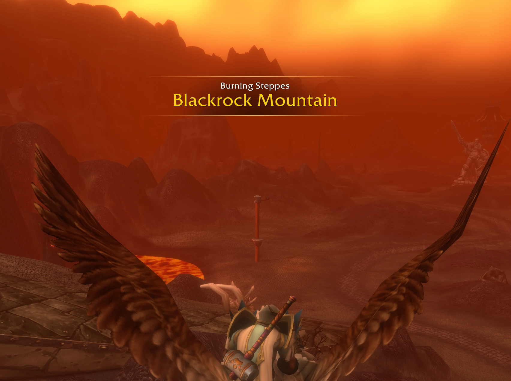

# ZoneBanner

Shows the area you walk into on a banner styled like the level-up banner.

Made for WoW: Forever.

## Features
- Replaces Blizzard's zone text with the banner.
- Adds a "Discovered" line when you find a new area, and hides Blizzard's own message.
- Has a short cooldown, so the same area doesn't keep repeating.
- Optionally shows only in cities and towns.

## Usage
- `/zonebanner` opens the options.
- `/zonebanner test` shows a test banner.

Development notes and the in-game test plan are in [docs/DEVELOPMENT.md](docs/DEVELOPMENT.md).
